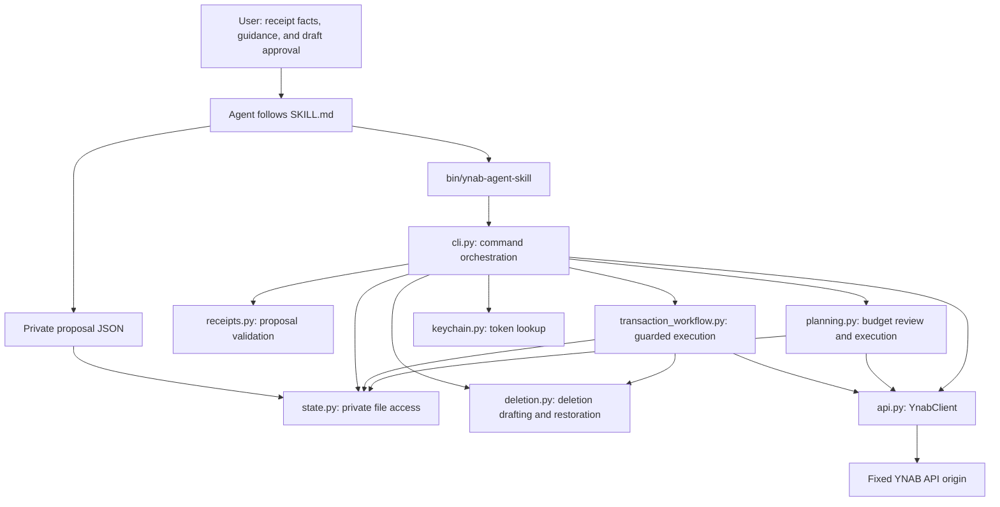
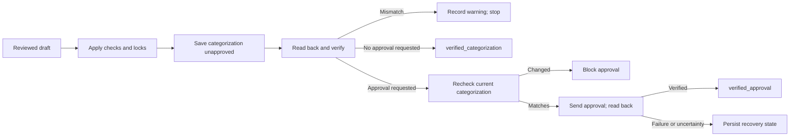

# Project structure and architecture

`ynab-agent-skill` has two cooperating parts: an agent skill that describes receipt review and monthly budget planning, and a local Python command that validates proposals and performs controlled YNAB operations. The command runs on demand; there is no background service, database server, bundled model, or OCR engine.

This guide maps the current implementation (versioned in `budget_tools/__init__.py`). Start with [README.md](README.md) for installation and everyday use, [the proposal reference](skills/ynab-agent-skill/references/proposal.md) for input JSON, and [VALIDATION.md](VALIDATION.md) for observed test results and remaining work.

## Repository map

```text
ynab-agent-skill/
├── .python-version                  Preferred Python 3.12 environment
├── pyproject.toml                   Package/version, dev tools and check scope
├── uv.lock                          Locked project development dependencies
├── install.sh                       Installer and active skill synchronizer
├── bin/
│   ├── ynab-agent-skill              Canonical executable launcher
│   └── ynab-codex-skill              Compatibility command alias
├── budget_tools/                    Internal Python package
│   ├── __init__.py                  Package version
│   ├── cli.py                       Parser, output and command dispatch
│   ├── transactions.py              Transaction reads, drafting and comparisons
│   ├── deletion.py                  Transaction deletion drafting, eligibility, and restoration
│   ├── transaction_workflow.py      Guarded execution and durable recovery
│   ├── utils.py                     Resolvers and shared helpers
│   ├── errors.py                    Shared command/workflow error
│   ├── planning.py                  Monthly reads and guarded budget assignments
│   ├── receipts.py                  Receipt proposal validation and normalization
│   ├── api.py                       HTTP transport and YNAB resource methods
│   ├── rate_limit.py                Persistent request accounting and waits
│   ├── keychain.py                  macOS credential lookup
│   └── state.py                     Private files, seals, atomic writes, and locks
├── skills/ynab-agent-skill/
│   ├── SKILL.md                     Shared agent instructions
│   ├── LICENSE.txt                  MIT notice for standalone skill distribution
│   ├── references/proposal.md       Version-1 proposal schema and example
│   ├── references/budget-planning.md Monthly read, review, and recovery guidance
│   ├── references/memos.md          Memo composition guidance
│   ├── references/long-runs.md      Batch checkpoints and recovery
│   └── agents/openai.yaml           Optional Codex display metadata and example prompt
├── tests/                           Core, receipt, creation, and API-contract tests
├── tools/                           Offline validation and quality scripts
│   ├── checks.py                    Suite runner for validation/tests
│   ├── consistency.py               Source manifest and doc-drift checks
│   ├── quality.py                   Quality diagnostic and JSON reporter
│   ├── runtime.py                   Local project interpreter selection
│   ├── run.py                       Installer bootstrap
│   ├── install_skill.py             Reviewed artifact staging and rollback
│   ├── dev_checks.py                Lint, format and boundary typing checks
│   ├── check_wheel.py               Exact wheel artifact audit
│   ├── source_manifest.txt          Explicit distribution allowlist
│   └── offline_guard/               Accidental access protection for tests
├── validation/                      Additional safety regressions and diagnostics
│   ├── test_receipt_workflow_requirements.py
│   ├── test_post_implementation_safety.py
│   ├── test_repair_safety.py
│   ├── audit_mutation_checks.py
│   ├── audit_new_payee_checks.py
│   ├── audit_transaction_read_checks.py
│   ├── mutation_support.py          Fault injection across lookup bindings
│   ├── audit_budget_planning_checks.py
│   ├── RECEIPT_ACCEPTANCE_CASES.md   Planned model evaluations, not completed tests
│   └── BUDGET_ACCEPTANCE_CASES.md    Planned planning evaluations
├── README.md                        Setup, supported behavior, and limits
├── AGENTS.md                        Generic contributor and engineering rules
├── ARCHITECTURE.md                  This guide
├── VALIDATION.md                    Recorded offline validation evidence
├── PRIVACY_REVIEW.md                Distribution review and exclusions
├── LICENSE                          MIT license and copyright notice
└── .gitignore                       Excludes private/local artifacts
```

The public command and skill share the name `ynab-agent-skill`. The legacy `ynab-codex-skill` command forwards to the canonical launcher; both use the same package, locks, credential lookup and private state. The Python package deliberately retains `budget_tools`. Credential lookup labels and the private-state directory also retain their existing names so a command rename does not strand credentials or pending recovery records. The default launcher imports the adjacent package. `pyproject.toml` also supports a CLI-only wheel with an explicit `budget_tools` package allowlist and both console aliases; it excludes private artifacts and the separate host skill installations. The root [MIT license](LICENSE) covers the project; preserve the identical `LICENSE.txt` when distributing the skill folder separately.

## Responsibilities and dependencies



These arrows show responsibility and data flow. `SKILL.md` is an instruction file; it does not execute Python. The agent interprets receipt evidence, invokes the command, and presents a concrete draft for user review. Python checks arithmetic and state transitions. Neither arithmetic validation nor the CLI's confirmation argument proves that receipt interpretation or human authorization was correct.

### Launcher and package metadata

[`bin/ynab-agent-skill`](bin/ynab-agent-skill) starts with `env python3`, finds its checkout from the launcher path, selects the verified local `.venv` when present (otherwise requiring Python 3.12), adds the root to Python's import path, and calls `budget_tools.cli.main()`. It disables bytecode-cache writes. The launcher and package must stay together; running it from another working directory is supported.

[`budget_tools/__init__.py`](budget_tools/__init__.py) declares `__version__`. The parser's version string and API user agent derive their versions from that single value.

### Command orchestration: `cli.py`

[`budget_tools/cli.py`](budget_tools/cli.py) contains argument parsing, output and dispatch. Transaction reads/drafting are in `transactions.py`, deletion and restoration in `deletion.py`, shared resolution/helpers in `utils.py`, and execution policy in `transaction_workflow.py`. Budget execution policy is in `planning.py`. Both guarded interfaces accept injected clients and own applicable authorization and lock checks independently of CLI callers.

| Area and owner | Functions to start with | Responsibility |
| --- | --- | --- |
| Entry and arguments | `build_parser`, `main` | Parse arguments, dispatch commands, emit JSON results and error messages |
| Setup and reads | `cmd_terms`, `cmd_auth`, `cmd_plans`, `cmd_accounts`, `cmd_categories`, `cmd_payees` | Notice acknowledgment, authentication checks, plan selection, resource listing |
| Matching (`transactions.py`) and resolution (`utils.py`) | `_transaction_query`, `_resolve_account`, `_resolve_category`, `_resolve_payee` | Request scoped records and resolve exact identifiers/names |
| Draft construction (`transactions.py`, formatting in `utils.py`) | `cmd_transactions`, `_validated_receipt_proposal`, `_receipt_payload`, `_receipt_draft_shape`, `_draft_public` | Assess a proposal, construct the API payload, save the reviewable draft, and format the preview |
| Deletion and restoration (`deletion.py`) | `create_draft`, `require_eligible`, `readback`, `finish`, `create_restoration_draft` | Draft guarded deletion, enforce eligibility/protected states, verify readback, and prepare manual restoration |
| Apply and recovery (`transaction_workflow.py`; CLI dispatch only) | `execute`, `_apply_draft_locked`, `_reconcile_draft_locked`, `_apply_receipt_approval_locked` | Enforce locks, confirmation, age, allowed states, writes, and recovery |
| Verification (`transactions.py`) | `_fingerprint`, `_transaction_invariants`, `_verification`, `_receipt_verification`, `_canonical_subtransactions` | Detect stale transactions and compare saved records with the intended result |

`main(argv, store=...)` accepts an injected `StateStore` for isolated tests. Production `_client()` obtains a token through `keychain.py` and constructs `YnabClient`. Many tests replace `_client()`; API-contract tests instead provide the real client with an offline transport.

Transaction reads separate transport from presentation. `_transaction_query` obtains scoped, non-deleted parent records; `cmd_transactions` applies exact signed-amount filters and display limits. Default list and match use `_transaction_summary`. Opt-in `transactions list --include-splits` and single-record `get` share `_transaction_detail`, preserving parent context and live child categories, signed amounts, and memos. Bulk formatting never calls single-record endpoints. This change adds no persistence format, schedule resolver, reporting classifier, or write workflow; existing seals, expiry, locks, verification, and recovery stay in their current layers. `tests/test_transaction_reads.py` exercises these read contracts and suffixed-ID apply/recovery through the real client with synthetic transport.

### Budget planning: `planning.py`

[`budget_tools/planning.py`](budget_tools/planning.py) owns monthly presentation and the `budget_assign` workflow. `read_budget()` joins category identity/group metadata with amounts from the explicitly requested month; current-month amounts returned by `/categories` never replace historical figures. Output retains exact decimal strings and integer milliunits. Available is the API balance, including rollover; whole-month Ready to Assign remains separate. The CLI performs decimal parsing using the existing exact-money helper.

`create_draft()` records one month's category assignment as an absolute milliunit total, even for increase/decrease requests. The existing review seal already covers `proposal` (month/category ID), `payload` (new `budgeted` total), `before_detail` (monthly totals, category snapshot and currency configuration), summary and changes. No change to the review-digest fields or existing transaction draft formats is needed. Draft output exposes before/after amounts and estimated consequences, not a claim of final balances.

`execute()` is the supported budget write entry point for both CLI and library callers. It verifies terms, reloads the sealed draft under a draft lock, obtains a plan-scoped budget lock, checks confirmation/status/expiry and selected plan, then compares fresh monthly state with the reviewed snapshot. The real client's write guard repeats validation after capacity waits or confirmed 429 rejections and persists `applying` before every send. It PATCHes only `category.budgeted` on the explicit month/category path. A definite rejection is failed; a confirmed 429 is pending; uncertain transport/server outcomes remain uncertain and cannot be reapplied. Acknowledged writes become verification-pending before fresh GETs verify category identity/status and the requested assignment.

Successful readback records `applied`; a mismatch records `verification_failed`. Interrupted or failed readback retains a non-replayable state. `drafts reconcile` uses the stored target and GETs only; it may establish that the desired state currently exists, not which client caused it. Budget drafts do not support `resume`. Readback shows current Available and Ready to Assign rather than assuming estimates became actual balances. Budget locks coordinate cooperating budget writers in the same state root, but not transaction writers, the YNAB UI, or other API clients. This is a single-category operation, not an atomic multi-category transfer or cross-client compare-and-set.

`tests/test_budget_planning.py` uses a synthetic endpoint model with the actual API serializer and CLI. The focused mutation runner deliberately breaks rollover handling, stale-state checks, expiry, sealing, readback, outgoing amounts and category eligibility. Model-level scenarios are separately listed in [budget acceptance cases](validation/BUDGET_ACCEPTANCE_CASES.md).

### Receipt rules: `receipts.py`

[`budget_tools/receipts.py`](budget_tools/receipts.py) owns `validate_receipt_proposal()` and exact decimal-to-milliunit conversion. It checks proposal version, selected plan/transaction, expected account/date/amount, receipt totals, allocation totals, currency precision, memos, evidence fields, unresolved facts, and supported tender count.

Its result is a normalized dictionary: category references become resolved category IDs, monetary values become integer milliunits, and allocation signs follow the transaction. For example, a synthetic outflow of `28.80` is `-28800` milliunits; positive allocation magnitudes become negative split amounts. A pure refund produces positive amounts.

This module does not directly open files or make HTTP requests. It receives the current transaction, currency precision, and a category-resolver callback. That callback is supplied by the CLI and may read categories through the API. Keep the exact input schema in [references/proposal.md](skills/ynab-agent-skill/references/proposal.md), rather than maintaining a second schema here.

### Network boundary: `api.py`

[`budget_tools/api.py`](budget_tools/api.py) provides `YnabClient`. Resource methods build paths for users, plans, accounts, settings, categories, payees, transactions, and budget months. Budget assignments use PATCH with a `category` JSON wrapper containing only `budgeted`. `request()` adds authentication and the user agent, encodes JSON, invokes the transport, decodes the response, and converts transport/API failures into `ApiError`.

The origin is fixed to `https://api.ynab.com/v1`. Resource IDs are checked before path construction, and the default urllib transport rejects authenticated redirects. `_safe_id` accepts nonempty ASCII letters, digits, hyphens and underscores, preserving posted recurring transaction IDs verbatim. It rejects separators, query/fragment delimiters, percent escapes, dot segments and non-string inputs. ID syntax never selects a scheduled endpoint or determines the transaction date. Creation uses POST and updates use PUT, with a `transaction` JSON wrapper. The client has no deletion method. Only confirmed HTTP 429 rejections are automatically retried; uncertain writes retain the existing recovery boundary.

[`budget_tools/rate_limit.py`](budget_tools/rate_limit.py) provides persistent per-token rolling-window accounting. The CLI attaches it to every real client. It reserves and flushes a slot before each attempt, uses server usage headers to account conservatively for external callers, and persists cooldowns. A token SHA-256 digest identifies the ledger; the token, URLs, payloads and financial contents are never stored there. Short token-scoped locks protect accounting across processes and are released before sleeping/network I/O. Missing state starts a new ledger; unsafe or corrupt existing state fails closed. A backwards clock conservatively extends the wait.

The transport returns status, body and response headers; injected legacy two-element responses remain supported. Workflow write guards revalidate the transaction after a rate wait or 429, recheck age immediately before sending, and save `write_started`/`approval_started`. Definite 429 rejection checkpoints return to `pending`/`approval_pending` with `write_rate_limited`/`approval_rate_limited` stages. An interrupted attempt without a recorded definite rejection remains subject to reconciliation. Revalidation reads consume quota too; a reserved slot abandoned to refresh validation stays conservatively charged.

The injected `transport` callable is the main testing seam for checking the real request-building code without connecting to YNAB. Client methods do not enforce user approval, draft expiry, or receipt rules; those belong to the guarded execution modules and the skill. Calling the client directly bypasses those checks.

### Credential boundary: `keychain.py`

[`budget_tools/keychain.py`](budget_tools/keychain.py) reads a macOS generic-password item through `/usr/bin/security`. It captures the result and returns the token to the API client without intentionally printing it. Lookup service `budget-tools-for-ynab` and account `personal` are compatibility labels. The module neither creates nor migrates credentials.

### Storage boundary: `state.py`

[`budget_tools/state.py`](budget_tools/state.py) provides `StateStore`, `read_private_json()`, and the underlying filesystem checks. It limits paths to recognized local storage under the user Library or `/private/tmp`, checks filesystem type, walks directories with no-follow descriptors, validates ownership/modes and regular-file properties, and performs atomic JSON replacement with flushes.

`save_draft()` seals the reviewed fields on first save and verifies that they remain unchanged on subsequent saves. Operational fields such as status and verification results can progress while the reviewed content remains fixed. A creation may learn its transaction ID after a response. This checksum detects accidental changes; it is not a defense against a malicious process running as the same user.

For a confirmed missing payee, `draft-receipt-create --new-payee` seals the exact name in the payload, summary, and changes. `_require_missing_payee()` checks name validity and absence during drafting and before application, including after rate-limit waits. The API receives `payee_name` with a null `payee_id` in the transaction request. `_record_created_payee()` retains the assigned ID as `resolved_payee_id` recovery progress without rewriting the sealed intent. `_receipt_verification()` checks the exact name and assigned ID; an ID-only acknowledgment learns the payee ID from the first verified read of the known transaction. Existing payee drafts keep their original ID-based path and seal format.

## Command groups and side effects

| Commands | YNAB effect | Local effect |
| --- | --- | --- |
| `--help`, `--version` | None | Exit before constructing private state or loading credentials |
| `terms status`, `terms acknowledge` | None | Read notice status; acknowledgment interactively updates configuration |
| `auth status`, `plans list`, `plans use`, `accounts`, `categories`, `payees` | API reads | May initialize private directories; `plans use` saves the selection |
| `transactions list`, `match`, `get`, `assess-receipt` | API reads | Read configuration/proposal as needed; may initialize private directories |
| `transactions draft-*` | API reads, no transaction write | Save a sealed local draft |
| `budgets months`, `budgets get` | API reads | Read configuration and rate-limit state |
| `budgets draft-assign` | API reads, no budget write | Save a sealed monthly assignment draft |
| `drafts list`, `show` | None | Read private drafts; listing may initialize private directories |
| `drafts apply` | May create/update/approve a transaction or set a monthly category assignment | Persist progress, verification results, and audit records |
| `drafts reconcile` | API reads only | Update recovery state and, when finalized, local audit records |
| `drafts resume` | May send remaining receipt approval | Persist approval progress and verification |

“Read-only” for reconciliation means no YNAB write. It does not mean no local filesystem changes. Likewise, creating a draft does not write a YNAB transaction, but it can require live API reads and stores private information locally.

## Receipt flow from evidence to verified result

1. The agent reads the user's receipt facts and guidance, obtains an exact account/date/amount match, and retrieves the full transaction. `match` reports the full candidate count before applying a display limit. Unique-match discipline is partly enforced by the skill; an explicit-ID draft is not bound to a stored match result.
2. The agent writes a private proposal. `_validated_receipt_proposal()` reads it through `state.py`, obtains currency settings, and invokes `receipts.py` with a category resolver.
3. `assess-receipt` chooses a route: an unapproved unsplit record can be drafted for conversion; matching existing splits can be drafted for approval; mismatched splits require manual correction; already-approved records are reported.
4. A draft stores the reviewed payload, normalized proposal, before-state fingerprint/invariants, and summary. The agent presents those facts and obtains the user's approval of that specific draft.
5. `drafts apply` loads and verifies the seal, checks confirmation/status/age, acquires locks, and rereads an existing target to reject changes since drafting. It persists `write_started` before sending a write.
6. For conversion or creation, categorization is sent with `approved: false`. A known returned ID is persisted before readback. Saved fields and split lines must match the expected result.
7. If approval was requested and categorization verifies, the workflow rereads the transaction, verifies it again, sends approval separately, then reads back and verifies the final result.



This diagram summarizes the receipt conversion/creation path. Existing matching splits use `receipt_approval` and skip the categorization write. Explicit new creation uses `receipt_create` and a null proposal transaction ID. Generic `draft-create` / `draft-update` use the separate `_finish_verification()` path; generic update rejects combining approval with other changes.

## Data records and recovery

| Record | Produced by | Main contents and purpose |
| --- | --- | --- |
| Proposal JSON | Agent following user guidance | Receipt evidence, expected transaction facts, category allocations, memos, unresolved facts, approval intent |
| Normalized proposal | `validate_receipt_proposal()` | Resolved IDs, signed integer amounts, normalized evidence and currency precision |
| Draft | CLI plus `StateStore.save_draft()` | ID, operation, plan/target, payload, before-state information, review seal, status/stage, and later recovery results |
| API payload | `_receipt_payload()` or `_transaction_changes()` | Fields to submit to YNAB; evidence and the full local draft are not uploaded wholesale |
| Verification result | `transactions.py` comparison helpers | `verified` boolean and field mismatches; receipt drafts distinguish categorization and approval checks |

Draft `status` expresses whether the operation is pending, in progress, uncertain, blocked, or complete. `stage` records the more specific checkpoint. They are related fields, not interchangeable names. Representative receipt states are:

| Situation | Status / stage | Meaning |
| --- | --- | --- |
| Ready for review | `pending` / `drafted` | No write attempted |
| Before sending categorization | `applying` / `write_started` | Intent persisted before the request |
| Write response lost | `uncertain` / `write_uncertain` | Server outcome is not known; do not replay |
| ID known, readback incomplete | `verification_pending` / `write_acknowledged` or `verification_pending` | Target is available for reconciliation |
| Categorization verified, approval outstanding | `approval_pending` / `categorization_verified` | Reconciliation/resume can handle remaining approval |
| Approval response uncertain | `approval_uncertain` / `approval_uncertain` | Reconcile before deciding what remains |
| Verification mismatch | `applied_with_warning` / a verification-failure stage | A write may have occurred, but the intended result is not proven |
| Verified completion | `applied` / `verified_categorization` or `verified_approval` | Requested receipt outcome verified |

The table is a guide to transaction workflows, not an exhaustive state-machine specification; the apply/reconcile functions contain the full branches. Transaction reconciliation requires a known transaction ID and never guesses one from amount alone. It can establish completion or return a receipt draft to `approval_pending`. Resume sends only the remaining receipt approval and enforces the same 24-hour expiry. Budget reconciliation instead uses its sealed month/category target, with no resume operation; its states are described in the budget planning section above.

`transaction_workflow.execute()` locks the draft and, for an existing known receipt/update target, the plan/transaction pair. That serializes local callers, including different drafts aimed at one transaction. A new creation has no target ID to lock before its first write, and these locks cannot coordinate with YNAB's UI or other API clients.

## Private files live outside the checkout

The default runtime directory is `~/Library/Application Support/Budget Tools for YNAB`:

```text
Budget Tools for YNAB/
├── config.json             Notice acknowledgment and selected plan
├── drafts/<draft-id>.json  Sealed reviewed content and recovery progress
├── locks/<scope-hash>.lock Local process coordination
└── audit.jsonl             Private operation summaries and verification evidence
```

This tree describes the implementation; it is not a sample of anyone's private state. The token resides separately in Keychain. Real proposals, drafts, receipts, and audit records do not belong in this repository. Local preparation handoffs and manifests are ignored artifacts, not application inputs. See [PRIVACY_REVIEW.md](PRIVACY_REVIEW.md) for distribution boundaries.

## Test organization

| File | Main coverage |
| --- | --- |
| [tests/test_receipts.py](tests/test_receipts.py) | Proposal arithmetic, normalization, currency precision, memos, and unsupported tender inputs |
| [tests/test_budget_tools.py](tests/test_budget_tools.py) | Money conversion, state/transport basics, matching, draft/apply behavior, split verification, and concurrency |
| [tests/test_receipt_creation.py](tests/test_receipt_creation.py) | Explicit receipt creation, readback, approval, lost responses, and preventing replay |
| [tests/test_new_payee.py](tests/test_new_payee.py) | Confirmed missing-payee drafts, unchanged existing-payee behavior, API contract, identity verification, rate waits, and recovery without replay |
| [tests/test_receipt_contract_workflow.py](tests/test_receipt_contract_workflow.py) | Real `YnabClient` with an offline server/transport; query filters, JSON wrappers, exact categories/memos, and recovery |
| [validation/test_receipt_workflow_requirements.py](validation/test_receipt_workflow_requirements.py) | Original workflow regressions: confirmation, expiry, ambiguity, readback, and redirect handling |
| [validation/test_post_implementation_safety.py](validation/test_post_implementation_safety.py) | Approval/recovery races, transaction invariants, split comparison, storage, and transport regressions |
| [validation/test_repair_safety.py](validation/test_repair_safety.py) | Filesystem protections, review seals, write failures, uncertain writes, and cross-process transaction locking |
| [tests/test_transaction_reads.py](tests/test_transaction_reads.py) | Opaque posted IDs, path rejection, default/bulk read contracts, exact split context, and suffixed-ID authorization/recovery |
| [tests/test_mutation_gates.py](tests/test_mutation_gates.py) | Mutation runners reject missed faults, test errors, and empty/failing controls |
| [tests/test_budget_planning.py](tests/test_budget_planning.py) | Monthly amounts, exact assignments, explicit review, stale-state/rate-wait checks, seals, locks and read-only recovery |
| [validation/audit_mutation_checks.py](validation/audit_mutation_checks.py) | Seven deliberate in-memory workflow/transport faults |
| [validation/audit_new_payee_checks.py](validation/audit_new_payee_checks.py) | Four deliberate missing-payee faults |
| [validation/audit_transaction_read_checks.py](validation/audit_transaction_read_checks.py) | Ten deliberate ID/path, split-context, default-contract and request-count faults |
| [validation/audit_budget_planning_checks.py](validation/audit_budget_planning_checks.py) | Seven deliberate budget read and write-safety faults |

Some tests share fixtures across both directories: `FakeClient` lives in `tests/test_budget_tools.py`, and `OfflineCase` / `ReviewClient` live in `validation/test_post_implementation_safety.py`. Keep both directories available when running tests. `validation` works as a Python namespace package without an `__init__.py`.

Run both unittest discovery commands and all four mutation diagnostics in [README.md](README.md#offline-verification). Running only one directory omits coverage. Dated results are in [VALIDATION.md](VALIDATION.md); they do not mean model interpretation cases or live pilots have passed. The receipt and budget acceptance checklists are evaluation plans, not executable test suites.

## Where to make a change

| Intended change | Start here | Follow through |
| --- | --- | --- |
| Add/change a command | `cli.py`: `build_parser`, dispatch, relevant handler | Help text, README, and command behavior tests |
| Change budget reads, assignments or recovery | `planning.py`, budget dispatch in `cli.py` | Monthly API contracts, budget tests, mutation checks, and budget skill reference |
| Change receipt fields or arithmetic | `receipts.py` | Proposal reference, CLI normalization/payload use, receipt tests |
| Change matching or category resolution | `transactions.py`: query helpers; `utils.py`: resolvers | API-contract tests with independent filters and exact expected results |
| Change an HTTP request or response assumption | `api.py` | Verify the relevant official contract; exercise the real client against the offline transport |
| Change apply, approval, or recovery behavior | `transaction_workflow.py`: guarded execute; `transactions.py`: comparisons | Failure, stale-state, uncertain-write, and concurrency tests in both directories |
| Change private storage or reviewed fields | `state.py` and draft construction in `transactions.py` | Ownership/symlink/atomic-write tests, review-seal compatibility, recovery behavior |
| Change how The agent interprets or reviews a receipt | `SKILL.md` and its proposal reference | Skill validation and separately observed interpretation evaluations |

Use synthetic fixtures for development. Preserve exact expected categories, amounts, memos, and attempted-write counts where they matter; a balanced total alone cannot demonstrate a correct financial change. Documentation edits should be checked against the implementation and linked files without running live account commands.

## Shared host installation and offline checks

`install.sh` delegates to `tools/install_skill.py`, which distributes one allowlisted skill to Codex and Antigravity IDE. Host UI metadata stays in `agents/openai.yaml`; financial behavior remains in the shared Python application. Staging, byte verification, private preference preservation, per-host recovery archives and caught-failure rollback protect updates. No app registration or live financial test is implied by file installation.

`tools/quality.py` launches the same isolated offline suites for either host and records source-bound results. `tools/offline_guard/sitecustomize.py` propagates accidental-access restrictions to reviewed Python children. `tools/consistency.py` checks a bounded set of public contracts against an explicit source manifest. These tools do not replace semantic review, hostile-code isolation, model interpretation evaluations or a separately authorized live pilot. Guarded transaction execution and CLI-only wheel packaging are implemented. Transaction read/draft handlers still adapt argparse/output through `transactions.py`; further domain separation and strict typing of older modules remain future work. Development tools are separate from the offline financial gate; their checked scope is explicit, and wheel contents require a separate artifact audit.
